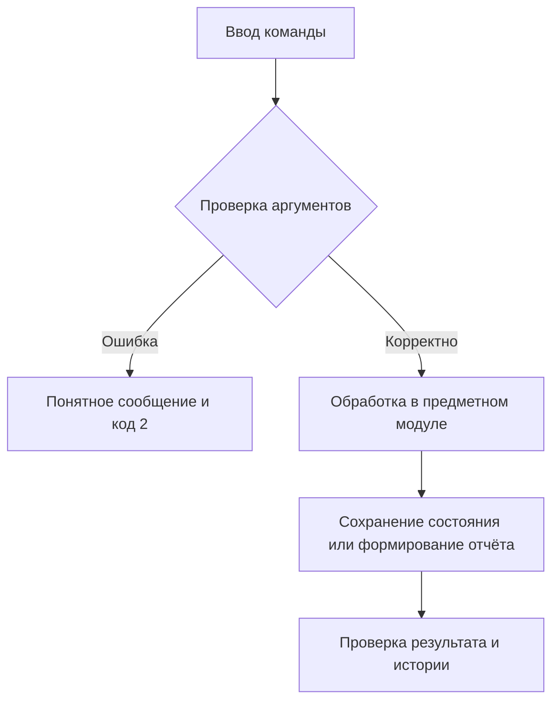

# Отчёт. Практическая работа №19–20

## Задание 4. Управление задачами и конфликтами Git

Дата: 5 ноября 2026 года.

## Цель

Разработать работающее приложение по заданию 4, проверить корректность,
организовать версионность и документировать применённые практики управления конфигурацией.

## Архитектура

SQLite tasks; CRUD, комбинированная фильтрация, статистика. Реальный учебный конфликт задокументирован в CONFLICT_REPORT.md.

Стек: Python 3.11/3.12, стандартная библиотека, pytest 8.3.5, ruff 0.11.13;
сборщик hatchling 1.27.0. Зависимости фиксируются в pyproject.toml и uv.lock.
Консольный интерфейс — src/task_manager/cli.py, логика — src/task_manager/core.py,
тесты — tests/. Платформа задания 8 отдельно определяет схему в storage.py.

## Схема алгоритма

Проверка полей → транзакция SQLite → CRUD → фильтры → агрегирование по статусам.



## Основной фрагмент реализации

Код из src/task_manager/core.py, функция statistics:

```python
    def statistics(self):
        counts = {s: 0 for s in STATUSES}
        counts.update(dict(self.db.execute("SELECT status,COUNT(*) FROM tasks GROUP BY status")))
        total = sum(counts.values())
        return dict(
            counts, total=total, completion_percent=100 * counts["done"] / total if total else 0
        )
```

Полный исходный код находится рядом с отчётом. Для защиты работы следует разобрать
его самостоятельно; происхождение реализации не представляется как подтверждение
самостоятельного написания студентом.

## Запуск и полученные результаты

Команда демонстрации: `uv run python examples/demo.py` в отдельно клонированном проекте;
в общем workspace: `uv run --all-packages python task-manager/examples/demo.py` из корня.

```text
{'todo': 0, 'in_progress': 1, 'done': 1, 'total': 2, 'completion_percent': 50.0}
```

Основное свидетельство: [examples/tasks.json](examples/tasks.json).
Локальные тесты: **12 passed in 0.02s**. Ruff и справка CLI: успешно.
Полный протокол: [examples/verification.txt](examples/verification.txt).
Общий набор: **128 тестов пройдены на Python 3.12.14 и Python 3.11.16**.
Эти протоколы получены локально и не выдаются за GitHub Actions.

## Git и прослеживаемость

Каждый каталог — отдельный настоящий Git-репозиторий. История создавалась по этапам:
настройка пакета → функции → CLI → тесты → документация → демонстрации и проверка.
Функциональные ветки сохраняются после локального слияния; дата коммитов не подменялась.
Тег v1.0.0 фиксирует завершённое локальное состояние.

```text
feature-filter
feature-statistics
feature-tasks
main
```

Проверка: `git log --graph --oneline --all`, `git branch`, `git tag`, `git show v1.0.0`.
Подробные снимки всех репозиториев собраны в ../git-evidence.json.

Реальный конфликт и разрешение: [CONFLICT_REPORT.md](CONFLICT_REPORT.md).

## Ограничения и вывод

Нет сетевой совместной работы, авторизации и уведомлений. Дата — плановая дата задачи, формат YYYY-MM-DD.

Приложение выполняет локальные функциональные требования и имеет автоматизированные
проверки. Реализованные практики SCM и организационные правила описаны в SCMP.md.
Использование отдельных принципов ISO/IEC/IEEE 828:2012 не доказывает полного
соответствия стандарту. GitHub-подтверждения, где они требуются, остаются отдельным
внешним этапом до окончательной сдачи.
